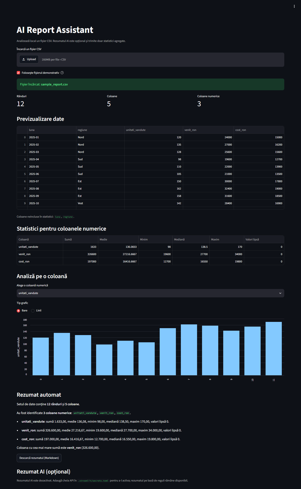

# AI Report Assistant

A local-first CSV analysis app built with **Python**, **Streamlit**, and **pandas**.
Upload a report, inspect the data, calculate statistics, visualize a numeric
column, and generate a deterministic summary. An optional LLM summary can be
enabled with an OpenAI-compatible API key.



## Why this project

This is a small portfolio project focused on the practical parts of a data/AI
workflow:

- safe CSV ingestion and validation;
- data profiling with pandas;
- a clear, testable Streamlit interface;
- deterministic summaries with an optional, privacy-conscious LLM layer.

The application works fully offline by default. No API key is required unless
the optional AI summary is enabled.

## Features

- Upload comma-separated or semicolon-separated CSV files.
- Automatic delimiter detection and UTF-8 BOM support.
- Table preview plus row, column, and numeric-column counts.
- Numeric column detection without assuming column names.
- Sum, mean, minimum, median, maximum, and missing-value counts.
- Bar and line charts for a selected numeric column.
- Deterministic, rule-based summary generated in Python.
- Download the rule-based summary as a Markdown file.
- Optional AI summary through an OpenAI-compatible API, with a rule-based
  fallback when the key is missing or the request fails.
- Clear validation messages for empty, malformed, header-only, non-UTF-8, or
  non-numeric files.
- Fictional demo dataset included.
- Automated tests with no real API calls.

## Screenshot

The screenshot above shows the app loaded with the included demo data. The
interface is in Romanian; the documentation is in English for portfolio
readability.

## Tech stack

- Python 3.14.3 (development and test environment)
- Streamlit 1.66.1
- pandas 3.1.0
- OpenAI Python SDK 3.38.0 (optional AI summary)
- Python `unittest` for tests

No database, Docker, cloud storage, or external deployment is required.

## Project structure

```text
.
├── app.py
├── requirements.txt
├── sample_report.csv
├── .streamlit/
│   └── secrets.toml.example
├── docs/
│   └── screenshot.png
├── tests/
│   └── test_app.py
├── .gitignore
└── README.md
```

## Installation on Windows

Open PowerShell in the project folder:

```powershell
cd "C:\Users\crist\Documents\Default Project"
python -m venv .venv
.\.venv\Scripts\Activate.ps1
python -m pip install -r requirements.txt
```

If PowerShell blocks the activation script, skip activation and use the
virtual environment's Python executable directly:

```powershell
.\.venv\Scripts\python.exe -m pip install -r requirements.txt
```

## Run the app

With the virtual environment activated:

```powershell
python -m streamlit run app.py
```

Or without activation:

```powershell
.\.venv\Scripts\python.exe -m streamlit run app.py
```

Open the local address shown in the terminal:

```text
http://localhost:8501
```

Press `Ctrl+C` in the terminal to stop the app.

## Usage

1. The **Use demo data** option is enabled by default, so the app opens with
   `sample_report.csv`.
2. Upload your own CSV to replace the demo data.
3. Review the row, column, and numeric-column metrics.
4. Inspect the preview table and the statistics for numeric columns.
5. Choose a numeric column and a chart type (**Bars** or **Lines**).
6. Download the deterministic summary as a Markdown file.
7. Optionally enable the AI summary by following the configuration section
   below.

## CSV requirements and limitations

- The first row must contain column names.
- The delimiter can be a comma or a semicolon; it is detected automatically.
- UTF-8 encoding is recommended; a UTF-8 BOM is supported.
- Numeric columns must contain actual numbers, for example `1250` or `1250.50`.
- Text columns are displayed but are not included in statistics or charts.
- The app does not assume specific column names.
- **Known limitation:** decimal commas such as `1250,50` are not converted
  automatically. Use a decimal point or normalize the values before uploading.

## Optional AI summary

The AI layer is disabled by default. To enable it:

1. Copy the example secrets file:

   ```powershell
   Copy-Item .streamlit\secrets.toml.example .streamlit\secrets.toml
   ```

2. Open `.streamlit\secrets.toml` in an editor and set your API key:

   ```toml
   [llm]
   api_key = "sk-your-api-key-here"
   model = "gpt-4o-mini"
   ```

   For another OpenAI-compatible provider, also set `base_url`.

3. Restart the app.

The app sends **only aggregate statistics and column names** to the configured
provider, not the raw CSV rows. The rule-based summary remains available as a
fallback. API usage may incur costs from your provider.

`.streamlit/secrets.toml` is excluded by `.gitignore`. Never commit real API
keys. The repository includes only the placeholder
`.streamlit/secrets.toml.example`.

## Tests

Run the full test suite:

```powershell
.\.venv\Scripts\python.exe -m unittest discover -s tests -v
```

The 18 tests cover:

- CSV loading, delimiter detection, and validation errors;
- numeric column detection and descriptive statistics;
- rule-based summaries;
- privacy of the LLM prompt (no raw values);
- mocked API responses and empty-response handling;
- Streamlit UI smoke tests.

No test makes a real network request.

## Troubleshooting

**Port 8501 is already in use**

Start the app on another port:

```powershell
python -m streamlit run app.py --server.port 8502
```

Then open `http://localhost:8502`.

**The app does not find the CSV**

Use a CSV with a header, UTF-8 encoding, and a comma or semicolon delimiter.

**No numeric columns are detected**

Check that the values are real numbers, not quoted text or decimal-comma
values. For example, `1250.50` works, while `"1250,50"` is treated as text.

**The AI summary is disabled**

Verify that `.streamlit/secrets.toml` exists, contains an `[llm]` section, and
includes a non-empty `api_key`. Restart Streamlit after changing secrets.

## Scope and limitations

This is a local MVP, intentionally kept small:

- no authentication, database, Docker, or deployment;
- no automatic handling of decimal commas;
- no PDF or Excel ingestion;
- no GitHub Actions in this version;
- one optional AI provider interface via the OpenAI-compatible API.

## Data and privacy

The demo dataset is fictional and contains no personal or banking data.

The base app runs locally and does not send data anywhere. If the optional AI
summary is enabled, aggregate statistics and column names are sent to the
configured provider. Do not upload confidential, client, or personal data
without the appropriate privacy and security review.
